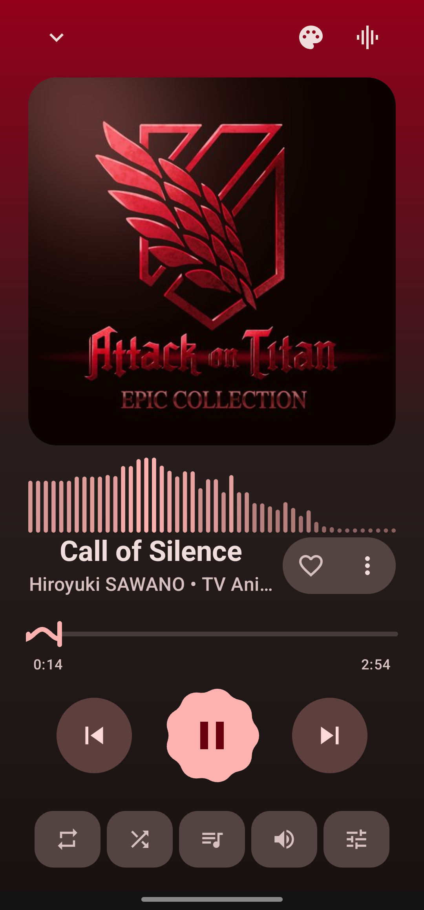
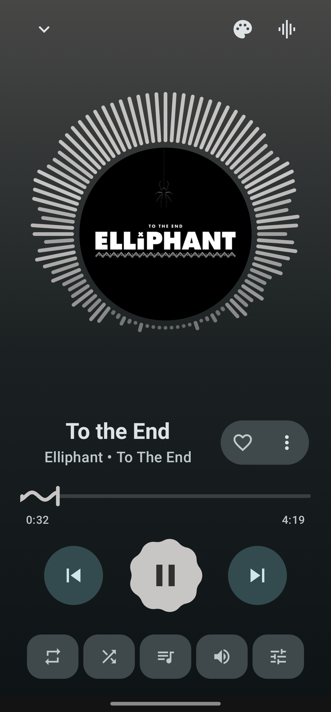
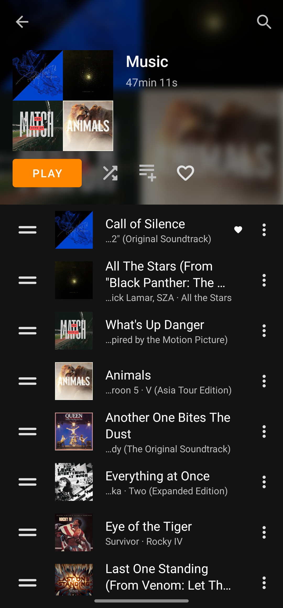
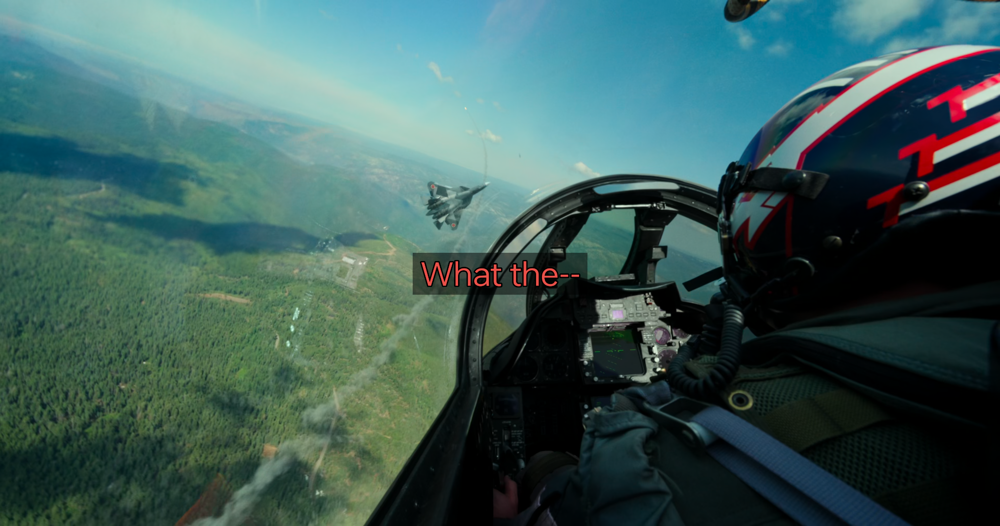
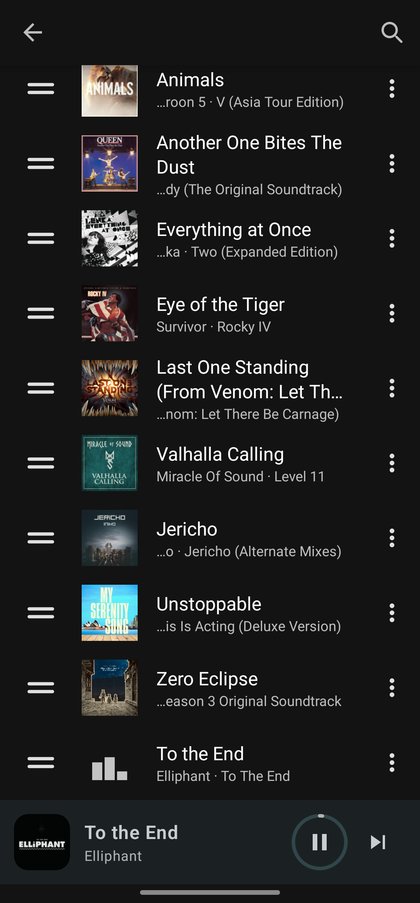
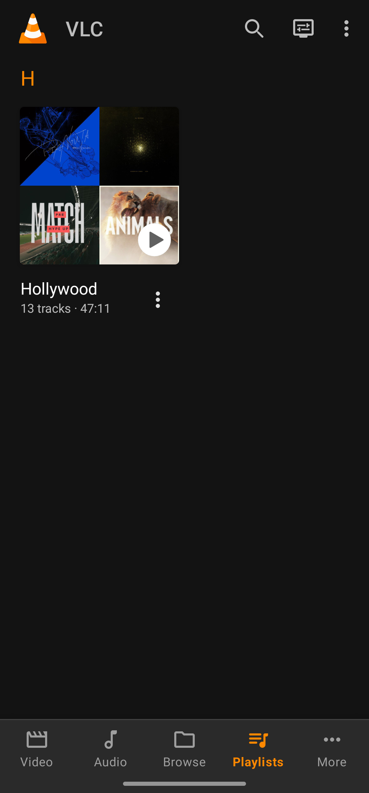

<div align="center">

# VLC for Android, Music Mode & Subtitle Studio

**A fork of VLC for Android with a redesigned music player, full control over how subtitles look,
and an API your AI assistant can use to manage your library.**

[](COPYING)
-3DDC84?logo=android&logoColor=white)



&nbsp;

&nbsp;


</div>

> **Unofficial fork.** This project is not made or endorsed by VideoLAN. It builds on the open source
> [VLC for Android](https://code.videolan.org/videolan/vlc-android) and keeps its engine, license and
> everything that makes VLC play *anything*.

---

## Why this fork

VLC plays every file you throw at it, but a few everyday things always felt rough. This fork fixes them.

| Before | Now |
| --- | --- |
| Subtitle style lived deep in Settings, and saving a change **stopped the video and closed the player**. | A **Subtitle style** panel inside the player. Changes reload the video in about a second and **resume at the same spot**. |
| No way to move subtitles. | **Move subtitles up or down, live**, to clear burned-in text or sit in the black bars. |
| Background box defaulted to white when no color was set. | Defaults to the black box you actually expect. |
| Music playback was a utilitarian list. | A modern **Now Playing** screen with four styles, a live visualizer and a cover-tinted mini player. |
| Fixing a song's tags meant another app. | A built-in **tag editor** that cannot corrupt your file. |
| Managing a library by hand. | A token-protected **API and MCP bridge** so an AI assistant can build playlists for you. |

---

## Subtitle Studio

<div align="center">


&nbsp;


*Yellow on a box at the default spot, then red and lifted to the middle of the screen. Colour, background and position are all changed from inside the player.*

</div>

Open **Tracks → Subtitles → Subtitle style** while a video plays.

- **Presets, one tap:** Default, Large text, Largest text and contrast, With background, Yellow, Yellow with background.
- **Fine control:** text size, bold, text color, background box (color and opacity), outline, shadow.
- **Live preview strip** shows the exact look on a dark and a bright band before you commit.
- **Position slider** moves the subtitles up or down without reloading. Drag the preview strip for the
  same effect. Lift them up to 40% of the screen height, or lower them slightly. It is also the fix for
  a classic annoyance: zoom a video in to fill the screen and the subtitles slide off the bottom, so you
  can now pull them back.
- **Opens at half height** so the video and the moving subtitles stay visible above the panel.
- **One reload, only when needed.** Position changes never reload. Style changes reload once when you
  close the panel, and changing something back to how it was does not reload at all.
- **Shared with Settings.** The panel and the Settings screens (phone and TV) read and write the same
  values and use the same presets.

<details>
<summary>How it works</summary>

LibVLC reads subtitle style only when its instance is created, so there is no runtime switch to flip.
When you close the panel after a style change, the app saves the position, rebuilds the LibVLC
instance, re-attaches the video surface to the new player and resumes playback at the saved time,
all without leaving the player screen. Position is applied by moving the subtitle surface, which is
why it can update instantly.

**Known limitations**

- The position slider moves the surface libVLC draws subtitles on. On at least one 4K hardware-decoded
  file we tried, the subtitles did not follow it, so the position may have no effect for some videos.
  Style changes (size, colors, background, outline, shadow) work on every file.

</details>

---

## Music Mode

<div align="center">


&nbsp;&nbsp;


</div>

Built with Jetpack Compose.

- **Now Playing, four styles**: Normal, Full cover, Gradient and Expressive, with a wavy seek bar,
  a cookie-shaped play button and a queue sheet.
- **Cover-tinted mini player** that picks up the colors of the current album art.
- **Live visualizer** with four looks: bars, wave, ring and glow.
- **Landscape two-pane layout**, and Now Playing now survives rotation correctly.
- **Tag editor** with safe writes: it edits a copy, verifies the result, and only then replaces the
  original. It shows the file name and treats the TagLib `(null)` placeholder as an empty field.
- **Favorites** read straight from the media library, and cover art with URL-encoded paths now loads.
- **Music player settings** to tune the experience.

---

## AI access

This fork adds a token-authenticated JSON API to **Remote Access**, with an **AI access tokens**
screen to create tokens (and revoke them all), and [`vlc-mcp`](tools/vlc-mcp), an
[MCP](https://modelcontextprotocol.io) server that lets Claude or any MCP client manage the music on
your phone: what is playing, the queue, library search, and creating and editing playlists.

> *"Make a playlist called Road Trip with songs by Arijit Singh and put it on shuffle."*

The phone's certificate is pinned by the helper, tokens are shown once, and deleting a playlist needs
an explicit confirmation. See [`tools/vlc-mcp/README.md`](tools/vlc-mcp/README.md) for setup.

---

## Everything VLC already does

The engine is unchanged: **LibVLC**.

- Plays every media format, codec and streaming protocol
- Hardware and efficient decoding on every platform, up to 8K
- Network browsing for SMB, FTP, SFTP, NFS, UPnP and DLNA
- Audio CD, DVD and Blu-ray playback with menu navigation
- HDR support, including tonemapping for SDR streams
- Audio passthrough over SPDIF and HDMI, including DD+, TrueHD and DTS-HD
- Video and audio filters, 360 video and 3D audio, casting to Chromecast and UPnP renderers

---

## Build

Requirements: a recent **Gradle (9.6 or newer)**, **JDK 17**, and the **Android SDK with platform 36**.
The repository has no Gradle wrapper.

```bash
git clone https://github.com/Nikhil1O1/vlc-android.git
cd vlc-android
echo "sdk.dir=$ANDROID_HOME" > local.properties

# Debug build: LibVLC and the medialibrary come prebuilt from Maven, only the app is compiled
gradle :application:app:assembleDebug
```

The APK is written to `application/app/build/outputs/apk/debug/`. A cold build takes a few minutes.

<details>
<summary>Build modes and building LibVLC from source</summary>

- `Release` and `Debug` fetch LibVLC and the Medialibrary as prebuilt libraries and build the app only.
- `SignedRelease` does the same and signs the APK with a local keystore.
- `Dev` builds LibVLC, the Medialibrary and then the app (via the build scripts only).

Building LibVLC needs a recent Linux distribution. See the
[AndroidCompile wiki page](https://wiki.videolan.org/AndroidCompile/) for the full list of
dependencies, then:

```bash
export ANDROID_SDK=/path/to/android-sdk
export ANDROID_NDK=/path/to/android-ndk
buildsystem/compile.sh -l -a <ABI>   # ABI: arm, arm64, x86, x86_64 or all
```

Use `-ml` instead of `-l` to build the Medialibrary, and `-r` for a release build.

</details>

---

## Project structure

| Folder | What it is |
| --- | --- |
| `application/` | The Android app, split into modules (phone, TV, resources, tools) |
| `tools/vlc-mcp/` | MCP server for managing your library with an AI assistant |
| `medialibrary/` | Medialibrary Gradle module |
| `libvlcjni/` | LibVLC Gradle module (VLC sources are cloned into `vlc/` at the root when building from source) |
| `buildsystem/` | Build scripts, CI and publication configuration |

---

## Contributing

Issues and pull requests for this fork are welcome here. If you are changing the UI or adding a
feature, please open an issue first so we can talk it through.

Fixes that belong to VLC itself are best sent upstream to the
[VideoLAN GitLab](https://code.videolan.org/videolan/vlc-android/), where translations are also managed
through [Transifex](https://app.transifex.com/yaron/vlc-trans/dashboard/).

---

## License and credits

VLC for Android is licensed under [GPLv2 (or later)](COPYING). Android libraries make this, de facto,
a GPLv3 application. The VLC engine (LibVLC) is licensed under LGPLv2.

Thanks to the VideoLAN team and every VLC contributor. VLC and the VLC cone are trademarks of VideoLAN.
